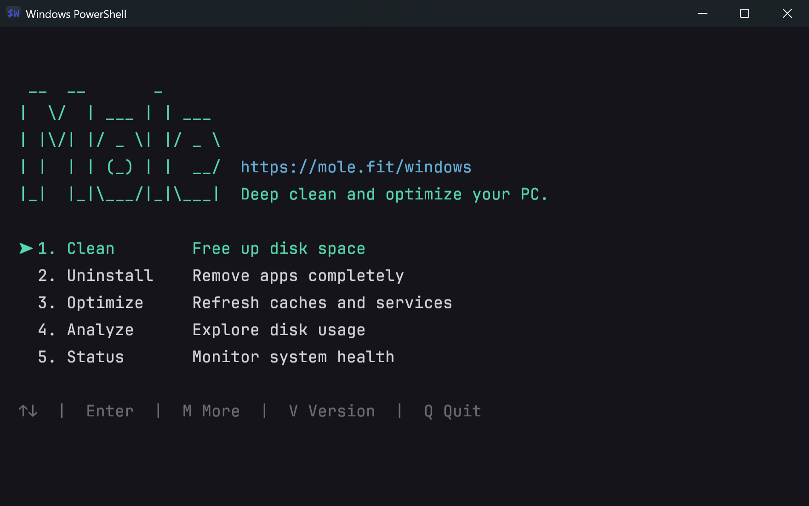
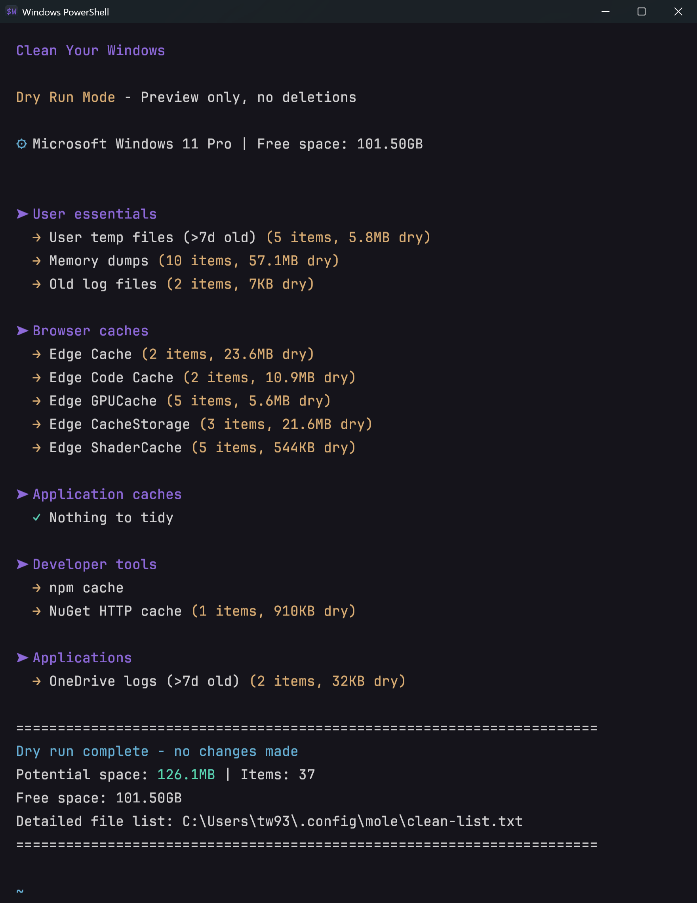
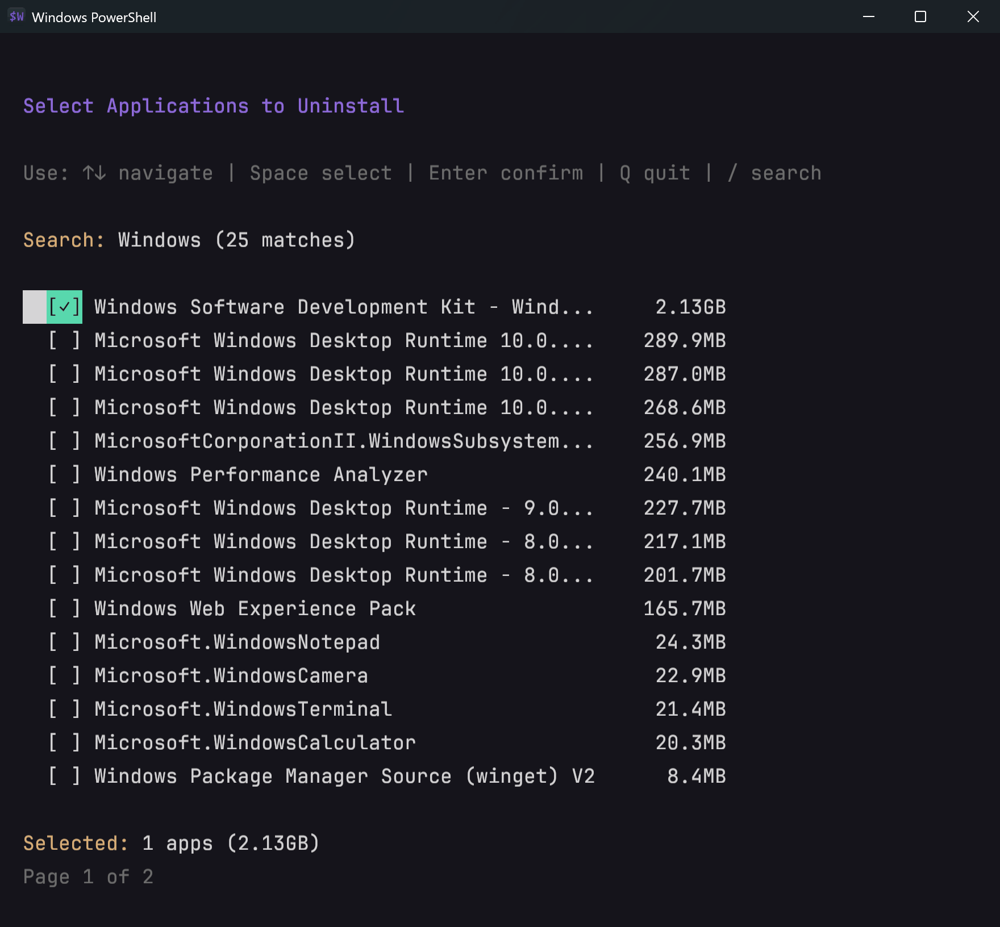
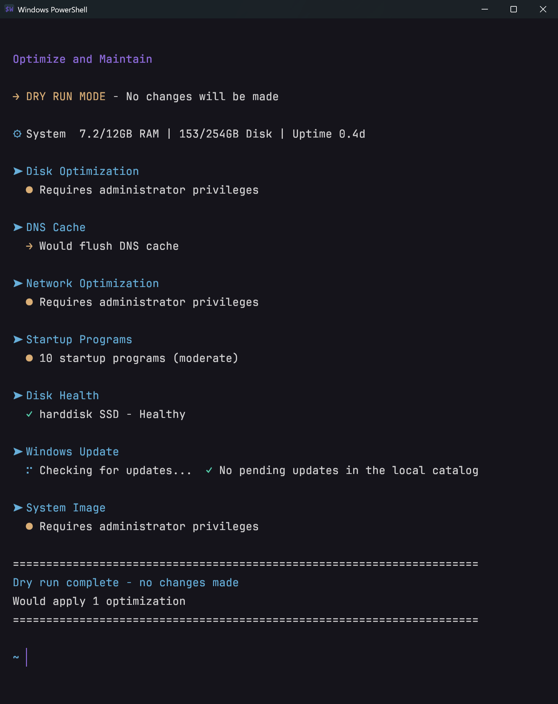
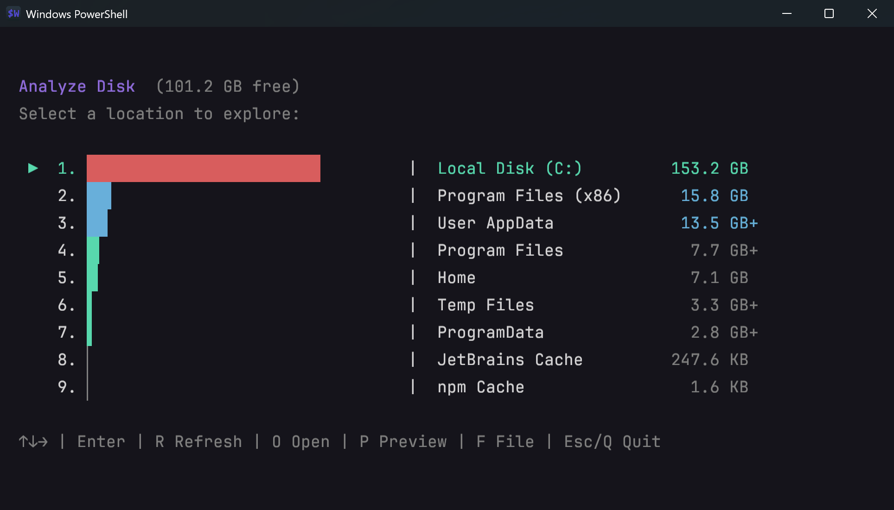
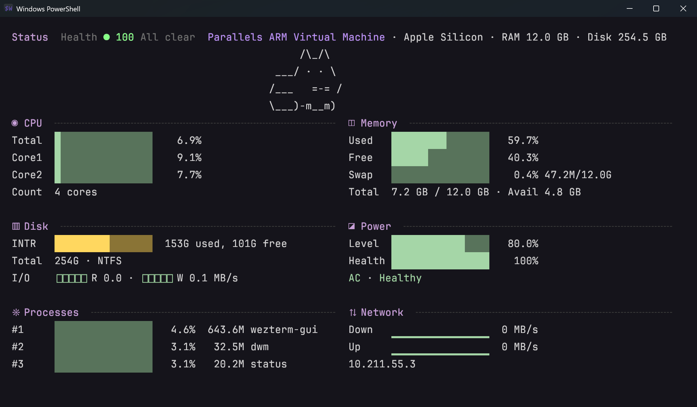

<p align="right"><a href="https://github.com/tw93/Mole">macOS</a> · <b>Windows</b></p>

<div align="center">
  <h1>Mole CLI for Windows</h1>
  <p><b>Глубокая очистка, удаление приложений, оптимизация, анализ диска и мониторинг вашего ПК с Windows. Бесплатный CLI с открытым исходным кодом.</b></p>
  <p><a href="README.md">English</a> · <a href="README_CN.md">中文</a> · <a href="README_TW.md">繁體</a> · <a href="README_JA.md">日本語</a> · <a href="README_KR.md">한국어</a> · <a href="README_DE.md">Deutsch</a> · <a href="README_FR.md">Français</a> · <a href="README_UA.md">Українська</a> · Русский</p>
  <a href="https://github.com/tw93/mole/stargazers"></a>
  <a href="https://github.com/tw93/Mole/releases"></a>
  <a href="LICENSE"></a>
  <a href="https://github.com/tw93/mole/commits/windows"></a>
  <a href="https://twitter.com/HiTw93"></a>
  <a href="https://t.me/+9f9gf4ZrFSQ2OWVl"></a>
</div>

<p align="center">
  
</p>

> 💡 Эта ветка содержит бесплатный CLI с открытым исходным кодом для Windows (`mo`). Нужно нативное приложение? [Mole for Windows](https://mole.fit/windows) загружается отдельно: очистка с просмотром перед удалением, обновление приложений, управление автозагрузкой, детальный разбор диска и состояние системы в реальном времени. CLI для macOS живёт в [ветке main](https://github.com/tw93/Mole).

## Возможности

- **Всё в одном CLI**: объединяет сценарии в духе CCleaner, IObit Uninstaller, WinDirStat и Диспетчера задач в одной команде терминала
- **Глубокая очистка**: удаляет временные файлы, кеши, журналы и остатки браузеров, освобождая место на диске
- **Умное удаление приложений**: удаляет приложения вместе с оставшимися папками установки
- **Анализ диска**: наглядно показывает, чем занят диск, в интерактивном TUI и находит крупные файлы
- **Обслуживание системы**: сбрасывает кеш DNS, оптимизирует системный диск и проверяет его состояние
- **Мониторинг в реальном времени**: показывает загрузку CPU, память, диск, сеть и статистику процессов

## Быстрый старт

Mole работает в Windows 10 и 11 со встроенным Windows PowerShell 5.1. Для установки скриптом нужен Git, а если источник отличается от последнего выпуска, то и Go для сборки нативных инструментов. Mole устанавливается в `%LOCALAPPDATA%\Programs\mole-cli` и добавляет `mo` и `mole` в PATH.

**Установка через Scoop**

```powershell
scoop install mole
```

**Или через скрипт**

```powershell
iwr -useb https://raw.githubusercontent.com/tw93/Mole/windows/quick-install.ps1 | iex
```

Mole распространяется только через этот репозиторий на GitHub, Scoop и [mole.fit](https://mole.fit/windows) (приложение для Windows). Сайты, которые предлагают приложение «на основе Mole» или просят вставить в терминал закодированную команду, не имеют к Mole никакого отношения.

**Через ИИ-агента**

Скажите своему агенту:

> Install Mole for me by reading https://raw.githubusercontent.com/tw93/Mole/main/llms.txt

Или установите скилл сами. С ним Claude Code, Codex, Cursor и другие агенты перед любым удалением показывают список через `--dry-run`, а удаление приложений и шаги с правами администратора оставляют вам. Обновление: `npx skills update -g -y`.

```powershell
npx skills add tw93/Mole -a claude-code codex cursor -g -y
```

Как плагин хоста: в Claude Code `/plugin marketplace add tw93/Mole`, затем `/plugin install mole@mole`, в Codex `codex plugin marketplace add tw93/Mole`, затем `codex plugin add mole@mole`.

**Запуск**

```powershell
mo                           # Интерактивное меню
mo clean                     # Глубокая очистка
mo uninstall                 # Удалить установленные приложения вместе с их остатками
mo optimize                  # Обновить кеши и службы
mo analyze                   # Наглядный обозреватель диска
mo status                    # Панель состояния системы в реальном времени
mo purge                     # Удалить артефакты сборки проектов

mo update                    # Обновить Mole
mo remove                    # Удалить Mole с этого ПК
mo --help                    # Показать справку
mo --version                 # Показать установленную версию
```

**Безопасный предпросмотр**

```powershell
mo clean --dry-run
mo uninstall --dry-run
mo optimize --dry-run
mo purge --dry-run
mo history
mo history --json

mo clean --dry-run --debug   # Предпросмотр + подробные журналы
mo clean --whitelist         # Управление защищёнными путями
mo clean --system            # Включить очистку системного уровня (запускайте от имени администратора)
mo purge --paths             # Настроить каталоги для поиска проектов
mo analyze D:\               # Анализировать другой диск
mo uninstall --list          # Список установленных приложений, в JSON через конвейер
mo analyze --json D:\        # Отчёт о диске в JSON
```

<details>
<summary><strong>Другие способы установки</strong></summary>

Чтобы просмотреть код перед установкой, клонируйте ветку `windows` и запустите установщик на месте. Каталог `.git` сохраняется, поэтому `mo update` будет работать и позже:

```powershell
$installDir = "$env:LOCALAPPDATA\Programs\mole-cli"
git clone --branch windows https://github.com/tw93/Mole.git $installDir
powershell -ExecutionPolicy Bypass -File "$installDir\install.ps1" -InstallDir $installDir -AddToPath
```

Добавьте `-CreateShortcut`, чтобы получить ярлык в меню «Пуск». Чтобы удалить Mole, выполните `mo remove`.

</details>

## Безопасность

Mole умеет удалять файлы, поэтому он проверяет пути и защищает системные расположения и профиль пользователя. `uninstall`, `purge` и `remove` запрашивают подтверждение перед любым удалением. Если Mole не может убедиться, что объект безопасно изменять, он пропускает его.

- `clean`, `uninstall` и `purge` могут удалять файлы, поэтому сначала просматривайте их с `--dry-run`, а при необходимости добавляйте `--debug`
- `clean` и `purge` удаляют безвозвратно; проверенные остатки `uninstall` попадают в Корзину, собственный деинсталлятор приложения сохраняет своё поведение, а файлы, удалённые в `mo analyze`, также попадают в Корзину
- Запускайте Mole от обычного пользователя; шаги системного уровня пропускаются, если PowerShell запущен не от имени администратора
- Защищайте пути через `mo clean --whitelist`
- Действия по очистке записываются в `%USERPROFILE%\.config\mole\operations.log`; просмотреть их можно командой `mo history`, а отключить запись можно переменной `MO_NO_OPLOG=1`
- `C:\Windows`, `C:\Program Files`, папки Windows Defender и корень вашего профиля никогда не затрагиваются

Загляните в [SECURITY.md](SECURITY.md), чтобы узнать, как сообщать о проблемах и какие границы безопасности действуют.

## Подробнее о возможностях

Скриншоты ниже сделаны на тестовом ПК. Доступные пункты и размеры зависят от вашего ПК.

### Очистка (Clean)

```powershell
mo clean --dry-run
```



Подробный список содержит все пути, найденные при предпросмотре. Скопируйте любой из них в белый список, чтобы сохранить его.

### Удаление приложений (Uninstall)

```powershell
mo uninstall
```

Показывает установленные программы из реестра и Windows Apps, начиная с самых крупных, затем удаляет выбранные вами через их собственный деинсталлятор и очищает оставшуюся папку установки. `mo uninstall --dry-run` показывает, какой деинсталлятор будет использован для каждого приложения и что будет удалено, ничего не запуская.



### Оптимизация (Optimize)

```powershell
mo optimize --dry-run
```



Шаги вроде оптимизации диска и сброса кеша ARP требуют прав администратора и без них пропускаются; запустите PowerShell от имени администратора, чтобы включить их.

### Анализ диска (Analyze)

```powershell
mo analyze
mo analyze D:\
```



Интерактивный обозреватель диска с тем же интерфейсом, что и в версии для macOS: стрелки перемещают по папкам, `Backspace` возвращает назад, `T` показывает самые крупные файлы, а `Del` после подтверждения перемещает выбранные объекты в Корзину.

### Состояние системы (Status)

```powershell
mo status
```



Панель в реальном времени с оценкой состояния, CPU, памятью, диском, питанием, сетью и самыми активными процессами.

### Очистка проектов (Purge)

```powershell
mo purge --dry-run
```

Находит артефакты сборки (`node_modules`, `target`, `build`, `dist`, `venv` и другие) в папках ваших проектов и позволяет выбрать, какие проекты очистить; пока вы не сделаете выбор, ничего не отмечено. Настроить сканируемые папки можно командой `mo purge --paths`.

## Сообщество

Спасибо всем, кто помогал создавать Mole. Подпишитесь на них! ❤️

<a href="https://github.com/tw93/Mole/graphs/contributors">
  
</a>

## Поддержать проект

- Самый прямой способ поддержать разработку Mole: приобрести [Mole for Windows](https://mole.fit/windows)
- Если Mole вам помог, поставьте звезду, [расскажите о нём](https://twitter.com/intent/tweet?url=https://github.com/tw93/Mole/tree/windows&text=Mole%20-%20Deep%20clean%20and%20optimize%20your%20Windows%20PC.) или откройте issue либо PR
- Вклад в проект приветствуется; сначала прочитайте [CONTRIBUTING.md](CONTRIBUTING.md)
- У меня двое котов, TangYuan и Coke; если Mole хоть немного облегчил вам жизнь, можете угостить их <a href="https://cats.tw93.fun?name=Mole" target="_blank">консервами 🥩</a>

## Лицензия

Mole представляет собой программное обеспечение с открытым исходным кодом под лицензией GPL-3.0; подробности в [LICENSE](LICENSE). Любая изменённая версия, которую вы распространяете, должна оставаться под той же лицензией. Если вы делаете форк Mole, пожалуйста, дайте ему другое название и укажите Mole как первоисточник; см. [TRADEMARK.md](TRADEMARK.md).
